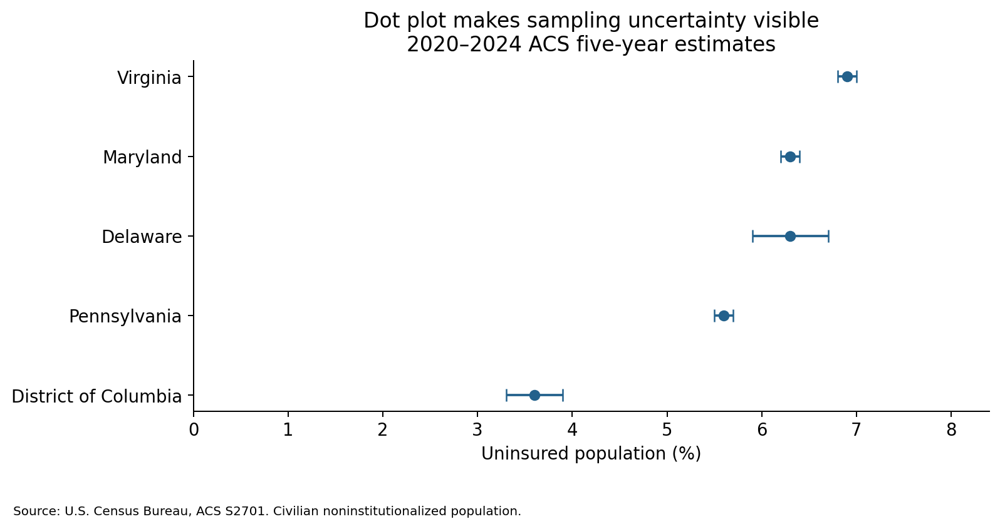

# ACS S2701 exploratory analysis for the sponsor meeting

Prepared for Thant Win on November 5, 2026.

**Status: actual-data analysis completed using the Census API.** Both official data snapshots, validation tables, provenance, and six draft charts are included. The API key is not included in source files or notebook outputs. This is an academic development repository; results and designs are subject to sponsor review.

## Sponsor meeting results

| Jurisdiction | Uninsured 2015–2019 | Uninsured 2020–2024 | 2020–2024 margin of error | Descriptive change |
|---|---:|---:|---:|---:|
| Delaware | 5.7% | 6.3% | ±0.4 pp | +0.6 pp |
| District of Columbia | 3.7% | 3.6% | ±0.3 pp | −0.1 pp |
| Maryland | 6.1% | 6.3% | ±0.1 pp | +0.2 pp |
| Pennsylvania | 5.7% | 5.6% | ±0.1 pp | −0.1 pp |
| Virginia | 8.6% | 6.9% | ±0.1 pp | −1.7 pp |

Margins of error use the published 90% confidence level. Changes are descriptive percentage-point differences; significance and causal effects have not been assessed. Maryland and Delaware share the same displayed rounded estimate and should not be ranked as different on that basis. These five-year estimates do not describe only the final year.

The selected 60 summary records contain no missing estimate or margin-of-error cells in the retained measures. Insured and uninsured counts reconcile with the relevant population totals, and displayed shares meet the rounding tolerance. These checks apply only to the selected rows and measures, not every S2701 variable or the entire survey.

## Run on GitHub

Open **Actions → Run Census S2701 EDA → Run workflow**. The manually triggered workflow reads the encrypted repository secret `CENSUS_API_KEY`, refreshes both data snapshots, and uploads the generated results as a downloadable Actions artifact. It does not commit the key or results back to the branch. The initial script run succeeded locally; the GitHub workflow has not yet been verified.

For local use, set `CENSUS_API_KEY` privately in your process environment. `.env.example` documents the name only; this script does not automatically load `.env` files. Existing CSV snapshots permit offline reruns without a key. A GitHub Actions secret is not automatically available in Databricks; configure a Databricks secret separately if refreshing there.

## Start here

1. Download S2701 from https://data.census.gov/ for **2024 ACS 5-Year Estimates Subject Tables** and **2019 ACS 5-Year Estimates Subject Tables**. Do not choose ACS 1-Year.
2. Use the geography filters to select Delaware, District of Columbia, Maryland, Pennsylvania, and Virginia. Verify the table header lists the selected jurisdictions. Selecting all states is also acceptable: the script retains only these five.
3. Choose **Download → ZIP**, the flat machine-readable format including GEOIDs, and select the 2024 and 2019 five-year products. Keep the ZIP filename containing the vintage, or extract its `-Data.csv` files without renaming them. Presentation-style CSV is not supported by this script.
4. Place the downloaded ZIP/CSV files in `data/`. Keep both official metadata JSON files already there.
5. Open `S2701_Sponsor_EDA.ipynb` in Jupyter or Databricks with this package folder available, and run the cells. Alternatively run `python s2701_eda.py` from the extracted folder.

The included data snapshots already permit analysis without a download. To refresh manually, follow the steps above.

Use Python 3.11+ with pandas 2.2+, numpy 1.26+, and matplotlib 3.8+. Install or attach these packages in your notebook environment if needed. An executed environment record is printed in the notebook. Dependencies are specified in `requirements.txt`.

### Databricks

Import the notebook and upload the package contents into a workspace or volume you can access. Set `PACKAGE_DIR` in the notebook to the absolute directory containing `s2701_eda.py` and `data/`. The script resolves input and output paths relative to its own location. Check that the directory is writable. This package has not been executed in your Databricks workspace.

### Optional API route

Set `CENSUS_API_KEY` privately through your environment or a Databricks secret, then run the same notebook. Do not paste a key into submitted code or commit it to GitHub. The script downloads data only when the corresponding local export is absent and saves a local CSV snapshot. Keys and full authenticated URLs are not saved. The API route was executed successfully for both vintages using a privately supplied key.

## What the workflow calculates

- Five jurisdictions × two periods × six population groups = **60 expected summary records**, not 60 surveyed individuals. The six groups are overall, three age bands, male, and female; overall and subgroup rows overlap and must not be added together.
- Missing values, annotation fields, duplicate/conflicting exports, percentage limits, insured/uninsured composition, and count consistency.
- Overall uninsured counts and percentages with published 90% margins of error.
- Descriptive differences in percentage points between the non-overlapping periods. No significance tests or causal conclusions.
- Unweighted summaries across jurisdictions, explicitly distinguished from a pooled descriptive rate computed from population counts.
- Bar, dot-with-uncertainty, lollipop, 100% stacked bar, slope, and grouped age comparison charts, plus CSV table alternatives.

The default pipeline requires both periods and all five jurisdictions. It stops rather than fabricate missing estimates. The chart designs are initial review examples, not a completed Census accessibility/compliance assessment. Inspect labels, layout, contrast, alt text, and uncertainty treatment before incorporating charts into the guidance website. The slope chart is a descriptive draft; statistical comparability review and uncertainty documentation remain required.

## Files

- `SPONSOR_MEETING_BRIEF.md`: talking points, decisions, limitations, and APA references.
- `S2701_Sponsor_EDA.ipynb`: analysis notebook with execution cells and interpretation prompts.
- `s2701_eda.py`: reusable loading, validation, analysis, and chart code.
- `data_dictionary.csv`: verified variable definitions for both vintages.
- `data/S2701_2019_metadata.json` and `data/S2701_2024_metadata.json`: official metadata snapshots.
- `results/`: created only when the analysis runs; includes source provenance, data checks, tables, and chart PNGs.

## Important interpretation boundaries

These are published survey estimates for the civilian noninstitutionalized population, not patient-level healthcare records. They describe insurance coverage rather than service utilization, quality of care, diagnoses, or health outcomes. ACS five-year estimates represent the full period, not a single year. Population figures are estimates, not survey sample sizes. DC is a state-equivalent jurisdiction. Do not average percentages to describe a combined population; use compatible counts and denominators and document any derived measure. Non-overlapping uncertainty intervals are not a substitute for a formal comparison test, and overlapping intervals do not establish equality. Do not attribute temporal changes to a policy or event from this EDA alone.
